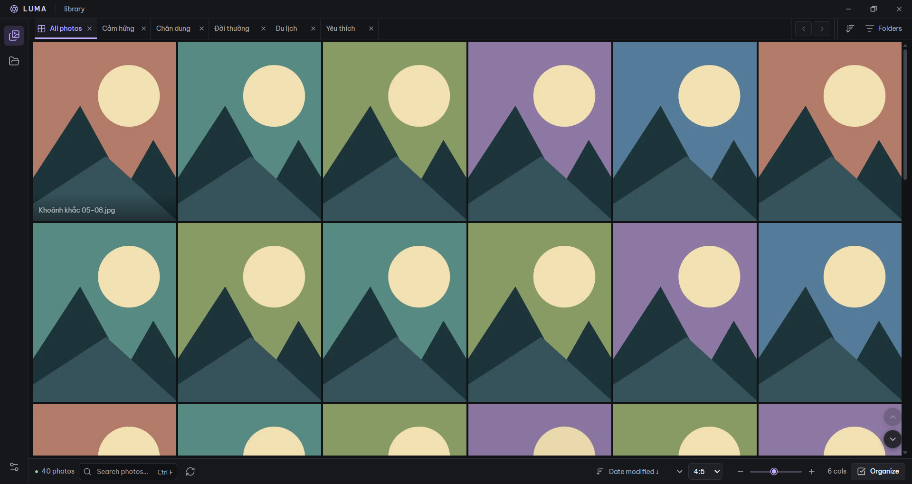
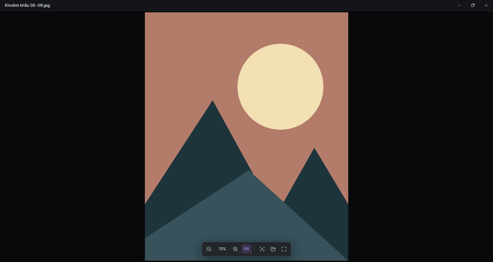

# Luma

### Your photos, in focus.

A focused photo browser for Windows. Open a folder, browse big photo grids, switch between folder tabs, and keep viewing in a separate window.

Free and open source · [MIT License](LICENSE) · Created by [Sanz2610](https://github.com/Sanz2610) · [Source snapshots](SOURCE.md)

## Download

Windows 10/11, 64-bit (x64). Luma is an early public release; feedback is welcome.

| Build | Best for | Updates |
| --- | --- | --- |
| **[Installer - Setup.exe](https://github.com/Sanz2610/luma/releases/latest/download/Luma-1.10.0-Setup.exe)** | Regular use. Installs to Program Files with Start/Desktop shortcuts. Administrator/UAC access is required. | Checks and downloads updates in the background. Choose **Restart to update** when ready. |
| **[Portable - Windows.exe](https://github.com/Sanz2610/luma/releases/latest/download/Luma-1.10.0-Windows.exe)** | Run without installing. Extracts on launch; settings are stored in your Windows profile. | Checks for new releases. Download the new portable file and replace the old one while Luma is closed. |

The current build has no publisher signing certificate, so Windows may show an unknown-publisher warning. Download from this repository's Releases and compare SHA-256 with `SHA256SUMS.txt` when needed. Versions before 1.6 require one manual update to gain the updater.

## Made for browsing

- **Photos first:** edge-to-edge grids with square corners, 1-12 full-width columns, square or 4:5 tiles, and crop/fit options.
- **Folders as tabs:** every immediate subfolder becomes a tab. The selected tab has a distinct background and rounded top corners. Drag to reorder, sort by name or date created, and add custom display names without renaming directories.
- **Find folders fast:** searchable folder browser in 1-4 columns, keyboard navigation and a Manage mode for sorting, renaming and hiding tabs.
- **Browse deeper:** the small footer path opens subfolders with breadcrumbs, search and parent navigation. A tab includes descendant photos; pick a deeper folder to view only that branch without more tabs.
- **Viewer:** keep browsing the library while a photo is open in its own window. Fit, actual size, wheel zoom, pan, fullscreen and navigation edges. Wheel defaults to zoom; choose **Viewer gear > Mouse wheel** or **Settings > Viewer** to scroll through next/previous photos instead. **Ctrl + mouse wheel always zooms**. Zoom has a short smooth animation and keeps the point under the pointer stable. Starting a drag takes over immediately; reduced motion skips animation. Wheel zoom-out stops at Fit; the slider goes smaller. Info shows dimensions, file size, dates, available DPI/bit depth and the source path. Click the image to hide/show the footer; double-click and pan keep their actions. Use the trash icon or Delete key to recycle the current photo and continue to the next.
- **Remember your workspace:** library and viewer restore their own windowed, maximized or fullscreen state.
- **Photo menu:** right-click a thumbnail for Open, Show in Explorer, Google Lens, Properties and Delete. Shift+F10 also opens the menu.
- **Organize:** drag a rectangle to select photos, including rows reached by edge autoscroll. Ctrl/Shift+drag adds to the selection; a blank click clears it. Deletion uses Windows Recycle Bin. Confirmation defaults on and can be disabled in **Settings > Deleting photos**.
- **Folder shortcuts:** attach a website or search text to an individual tab.
- **Google Lens:** explicitly search the current image using a preview in your default browser.

## Start in a minute

1. Install Luma or run the portable executable.
2. Choose the parent folder containing your photo folders.
3. Switch tabs and adjust **Thumbnail size** in the footer. Plus makes photos larger, minus makes them smaller; every step changes one column. Click an image to open the viewer.

Your photos stay in their source folders. Closing or renaming a tab does not move, rename or delete its directory. Closing **All photos** returns Home; select the root again to reopen it. Closed folders can be restored from **Folders → Hidden**.

If all folders were hidden, Luma explains the empty library and offers **Hidden folders** directly. About keeps one GitHub button, a clickable creator name, MIT license and optional Donate.

## Shortcuts

| Library | Viewer |
| --- | --- |
| **Ctrl+F** - search photos | **← / →** - previous / next |
| **Ctrl+K** - find a folder | **Mouse wheel** - zoom or next/previous (saved option) |
| **F5** - refresh | **0 / 1** - fit / actual size |
| **Ctrl+A** - select all in Organize | **Ctrl+mouse wheel** - always zoom |
| **F11** - fullscreen | **F / F11** - fullscreen |
| **Shift+click** - select a range | **Delete** - recycle current photo |
| **Shift+F10** - photo menu | **I / Esc** - Info / close viewer |

## Formats and large libraries

JPG/JPEG, PNG, WebP, GIF, AVIF, BMP, TIFF and HEIC/HEIF. GIF thumbnails are static; original GIFs animate. TIFF shows its first page. TIFF/HEIC use a converted display preview up to 4096 px. Camera RAW files show an embedded JPEG preview when one is available (CR2/CR3, NEF/NRW, ARW, DNG, RW2, ORF, RAF, PEF, SRW); Luma does not develop sensor data. Preview quality/size depends on the camera. Video is outside scope.

The grid and tabs are virtualized, and thumbnail decoding runs in a separate process. Regression checks include 240 folders and 4,800 synthetic photos. Very large originals, malformed files and slow/network drives can still affect speed and memory. Some compressed BMP variants and images above the 64 MP preview limit may lack thumbnails.

HEIC inputs above 128 MB are rejected before decoding. Codec notices and matching HEIC codec source archives accompany releases; see [Image codec sources](CODEC_SOURCES.md). Originals are not converted or overwritten.

## Updates, storage and privacy

**Settings → Updates** shows your version and update status. Automatic checking can be turned off. Installer updates download in the background and require an explicit **Restart to update**; Luma does not silently restart while you browse. Program Files updates can trigger UAC. Portable builds offer a new download instead of replacing themselves.

Browsing and thumbnail generation happen locally. Settings and cached previews live under `%APPDATA%\Luma`; the thumbnail cache is pruned toward 1 GB. The updater checks GitHub Releases and uses a separate update-download cache. Luma has no analytics or automatic diagnostic uploads.

**Google Lens is an explicit online action:** clicking its icon sends a bounded preview of the current photo to Google in your browser. Google may require login or CAPTCHA. Opening a configured folder link uses your browser too. Ordinary photo browsing does not upload photos.

## Feedback

Use **[Issues](https://github.com/Sanz2610/luma/issues)** for bugs and suggestions. Include your Luma version, Windows version, installer/portable build, steps to reproduce and the affected file type. Do not attach private photos or unredacted logs.

Enjoying Luma? **[Buy me a coffee](DONATE.md)** - optional support for its continued development.
